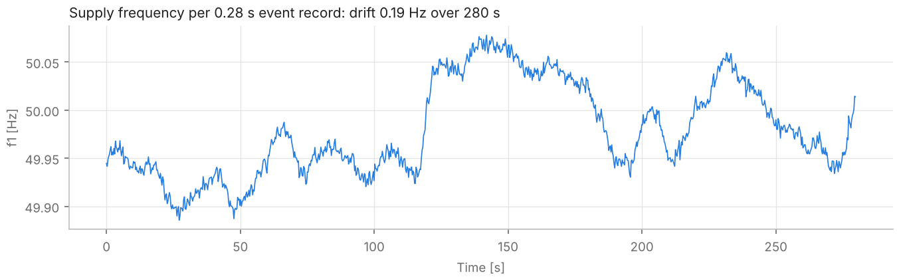
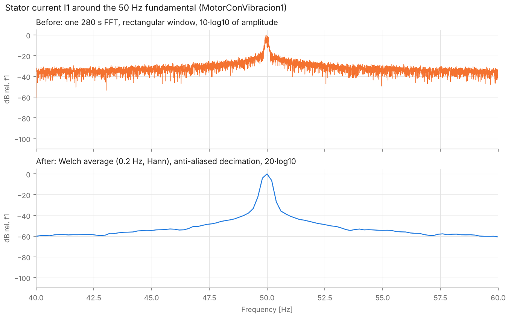
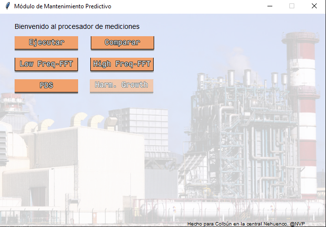
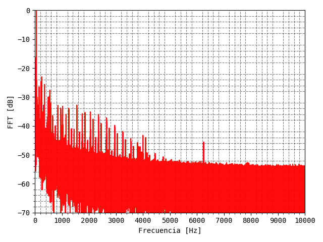
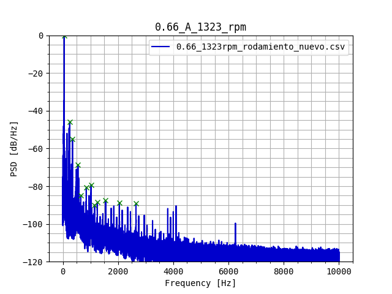
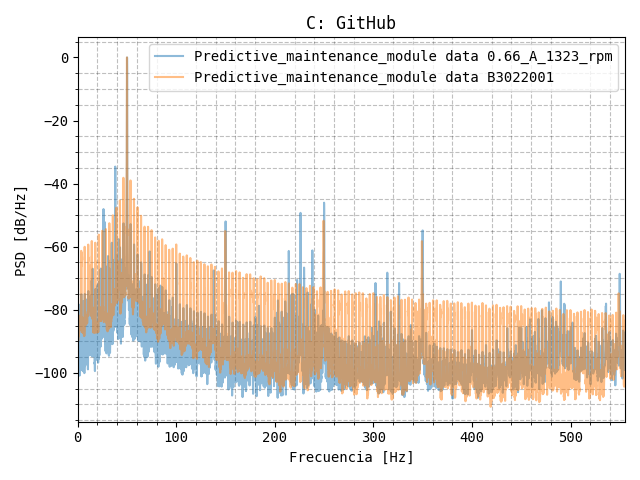

# CLB_fft: motor current signature analysis for HIOKI PQ ONE

[](https://github.com/NiCriViPe/CLB_fft/actions/workflows/ci.yml)

> *Código para integración de mediciones HIOKI PQ ONE y análisis espectral de
> corrientes de estator para el diagnóstico de motores de inducción.*

Developed around summer 2022 at Nehuenco-Colbún, this project turns stator-current
waveforms exported from HIOKI's PQ ONE software into spectra that an electrical
engineer can use to diagnose common induction-machine faults (MCSA: *motor current
signature analysis*).

It contains:

* **`clb_fft`**, a tested Python package and command-line tool (`src/clb_fft`).
* The original **Tkinter GUI** (`Predictive_maintenance_module/`) for interactive use.

Faults addressed:

1. Static and/or dynamic air-gap irregularities (eccentricity).
2. Broken rotor bars or cracked end-rings.
3. Stator faults (open or shorted turns in a phase winding).
4. Abnormal connection of the stator windings.
5. Bent shaft (akin to dynamic eccentricity), which can lead to rotor–stator rub.
6. Bearing and gearbox failures.

Diagnosis should (preferably) be confirmed by an electrical engineer able to
interpret current spectra. The automatic indicators are aids, not verdicts.

## Quick start (Windows)

1. Install **Python 3.10 or newer** from [python.org](https://www.python.org/downloads/windows/).
   During installation, tick **"Add python.exe to PATH"**. Tkinter is included.
2. Install the dependencies **once**. Open a terminal in the repository folder and run:

   ```bat
   pip install -r requirements.txt
   ```

3. Open the GUI: **double-click `Predictive_maintenance_module\Abrir_GUI.bat`**, or run

   ```bat
   cd Predictive_maintenance_module
   python gui.py
   ```

No other installation is needed: the GUI finds the analysis package in `src\` by itself.

### GUI buttons

| Button | What it does |
|---|---|
| **Ejecutar** | Joins the export parts (`x.csv`, `x_001.csv`, ...) and saves the current waveform (`_y-t_DATA.csv`) |
| **Comparar** | Overlays the PSDs of several measurements |
| **Low / High Freq-FFT** | Amplitude spectrum of the low band (0–500 Hz, anti-aliased) or the full band |
| **PDS** | Welch power spectral density with detected peaks |
| **Diagnóstico** *(new)* | Asks for the number of poles and the measured speed. Shows the measurement quality, the spectrum with the expected fault frequencies marked, and the broken-bar indicator. Saves `<measurement>_DIAGNOSTICO.txt` and `<measurement>_PICOS.csv` next to the data |

## Command line and Python API (optional)

The same analysis can be run without the GUI, for batches of files:

```bat
pip install -e .
clb-fft quality Measurements\NH-I\MotorConVibracion1.tar.xz
clb-fft analyze Measurements\NH-I\MotorConVibracion1.tar.xz --pole-pairs 2 --speed 1485 --out results
```

`analyze` writes `spectrum_low.png`, `spectrum_fundamental.png`, `psd_full.png`,
`frequency_track.png`, `peaks.csv` (every peak, labelled with its fault family)
and `summary.json`. Use your machine's nameplate data: the values above are only
an example.

```python
from clb_fft import load_hioki_csv, averaged_amplitude_spectrum, decimate, Motor
from clb_fft.diagnosis import assess_broken_bars

rec = load_hioki_csv(r"C:\path\to\Measurement.csv", channels=["I1"])  # finds _001, _002, ...
x, fs = decimate(rec["I1"], rec.fs, 20)                                  # anti-aliased
spec = averaged_amplitude_spectrum(x, fs, resolution=0.1)
motor = Motor.from_speed(f1=50.0, pole_pairs=2, speed_rpm=1485)
print(assess_broken_bars(spec, motor.f1, motor.slip).summary())
```

## What the data really looks like

A PQ ONE waveform export is a chain of short **event records** (here 1000 × 0.28 s).
Some joints between records are discontinuous, and the supply frequency drifts
during the capture:



This limits the useful resolution: one 280 s FFT does *not* resolve 0.0036 Hz.
The comparison below is the same signal, processed the original way and the
current way:



`examples/method_comparison.py` regenerates both figures. See
[`docs/REVIEW.md`](docs/REVIEW.md) for the full review, the bugs fixed, and the
roadmap.

## Method

| Step | Implementation |
|---|---|
| Load | Any number of `_NNN` parts; sampling rate inferred from the 1 ms timestamps |
| Check | Discontinuous record joints; per-record supply frequency (zero crossings) |
| Spectrum | Welch-averaged, Hann-windowed amplitude spectrum in peak units; `20·log10` for amplitudes, `10·log10` for PSD |
| Low band | FIR anti-aliased decimation |
| Fault frequencies | Broken bars `f1(1±2ks)`; mixed eccentricity `f1±k·fr`; rotor slot / dynamic eccentricity `f1[(kR±nd)(1−s)/p ± nω]`; shorted turns `f1[n(1−s)/p ± k]`; bearings `\|f1 ± m·f_v\|` from geometry |
| Indicator | Broken-bar sideband level vs. f1 (after Thomson & Fenger, 2001), reported only when the sidebands are resolvable **and** are true peaks |

## GUI screenshots

### Initial screen


### High-frequency FFT


### Power spectral density (PSD)


### Compare measurements


## Development

```bat
pip install pytest ruff
set PYTHONPATH=src
pytest              &:: 40 tests on synthetic signals with known answers
ruff check . && ruff format --check src tests examples
```

CI runs the same steps on Windows for every push.

## References

* W. T. Thomson, M. Fenger, "Current signature analysis to detect induction motor
  faults", *IEEE Industry Applications Magazine*, 7(4), 2001.
* M. E. H. Benbouzid, "A review of induction motors signature analysis as a medium
  for faults detection", *IEEE Trans. Industrial Electronics*, 47(5), 2000.
* R. R. Schoen et al., "Motor bearing damage detection using stator current
  monitoring", *IEEE Trans. Industry Applications*, 31(6), 1995.
